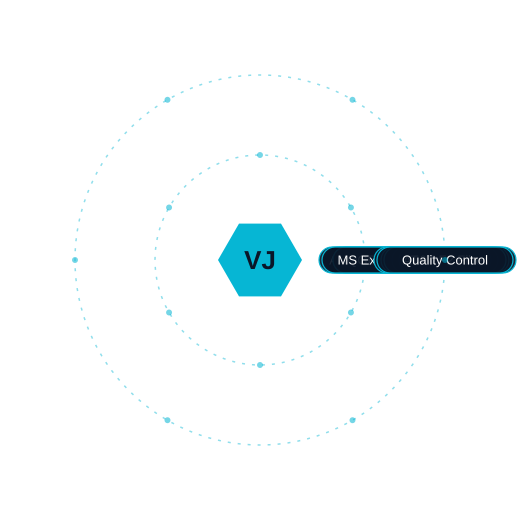
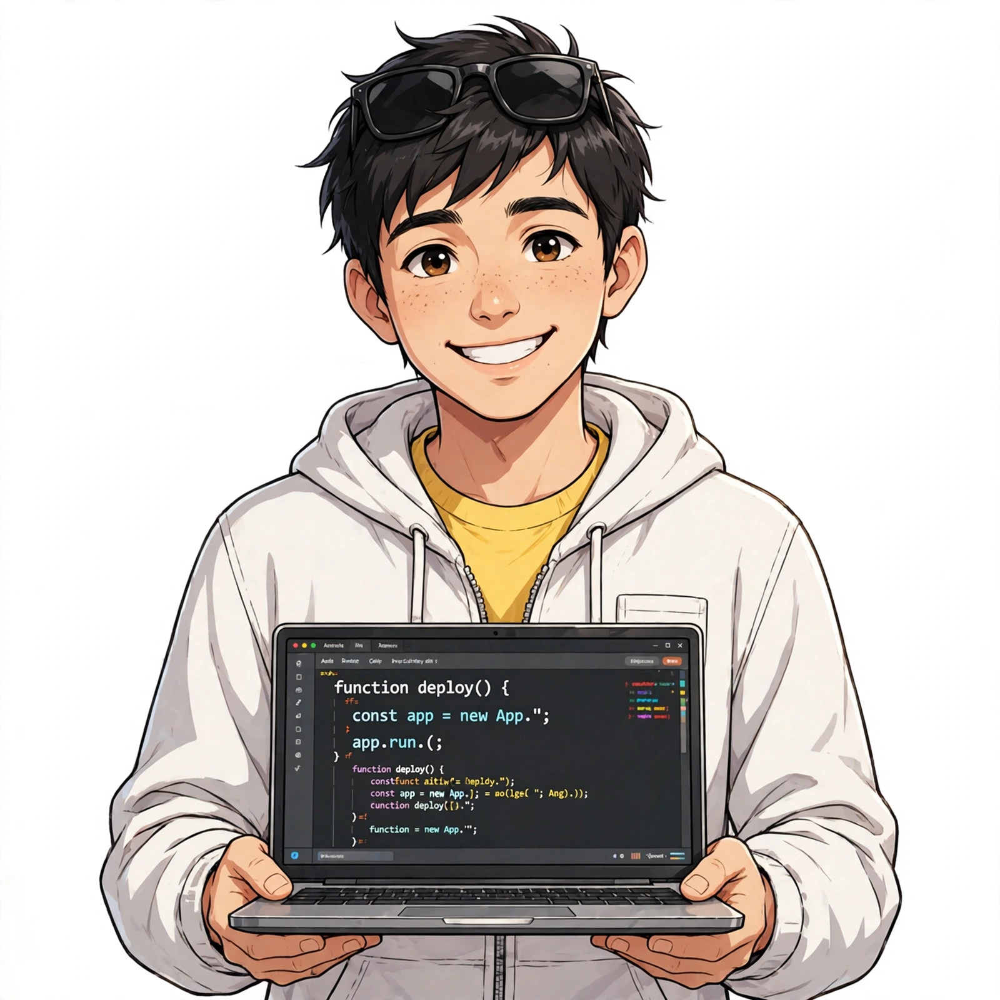
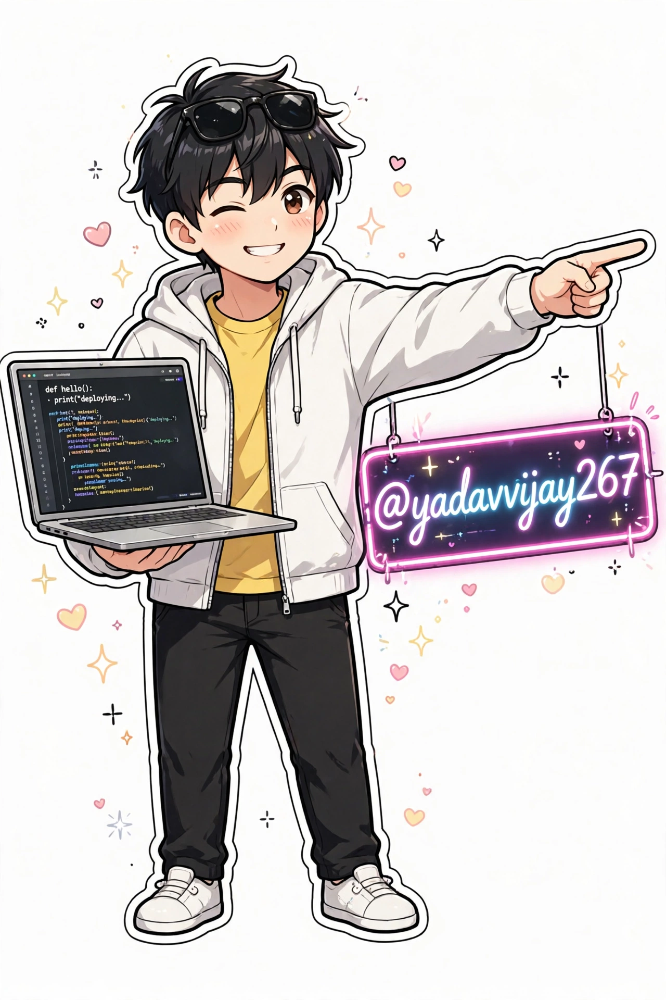

<!-- 1 · HERO -->

  

  

<h1 align="center">Vijay Kumar Yadav</h1>

  

  I catch design errors before they reach the field. 
  Telecom design engineer · 5+ years · AMSYS IT Service Pvt Ltd, Noida

  
  
  
  

---

## 🛠️ What I Build

<table>
  <tr>
    <td align="center" width="33%">
      <h3>📡 Fiber Network Design</h3>
      FTTH networks — underground &amp; overhead — designed end to end, from survey records to field-ready packages.
    </td>
    <td align="center" width="33%">
      <h3>🔍 Design Quality Control</h3>
      Design QC that catches errors before they reach the field — AT&amp;T F2 Fiber packages, checked line by line.
    </td>
    <td align="center" width="33%">
      <h3>🗺️ ARAMIS &amp; Fielding</h3>
      ARAMIS-DT and fielding packages for fiber builds, with GIS, plats and survey data woven in.
    </td>
  </tr>
</table>

---

## 🎡 Hobbies

  

---

## 🛰️ Tech Orbit

  

  
  
  
  
  
  
  
  
  
  
  
  

---

## 🪪 ID Badge

<table>
  <tr>
    <td align="center" width="180">
      
    </td>
    <td>
      <h3>Vijay Kumar Yadav</h3>
      <b>ID:</b> VY-267 
      <b>Role:</b> QC Engineer (Planning &amp; Designing) 
      <b>Company:</b> AMSYS IT Service Pvt Ltd 
      <b>Location:</b> Noida, India 
      <b>Experience:</b> 5+ years · 3 roles 
      <b>Focus:</b> AT&amp;T F2 Fiber · Quality Control · Fiber Design
    </td>
  </tr>
</table>

## 📊 Dashboard

  
  

  

  <b>🔵 Now:</b> QC Engineer @ AMSYS — AT&amp;T F2 Fiber design quality control · 350+ projects completed · 100+ quality checks

---

## 📂 Projects

| Project | What it is | Link |
|---|---|---|
| **Bio — Portfolio** | My portfolio site (static HTML/CSS/JS) — experience, case studies, skills, education | [bio.vijayyadav.workers.dev](https://bio.vijayyadav.workers.dev) |
| **ResuMate** | AI resume builder — ATS score checker, AI writer, interview coach, My Resumes dashboard | [resumate.vijayyadav.workers.dev](https://resumate.vijayyadav.workers.dev) |
| **AT&T F2 Fiber — Design QC** | Quality control of AT&amp;T F2 Fiber design packages | [Case study](https://bio.vijayyadav.workers.dev/case-studies) |
| **ARAMIS & Fielding** | Fiber design — ARAMIS-DT &amp; fielding packages | [Case study](https://bio.vijayyadav.workers.dev/case-studies) |
| **FTTH Network Design** | FTTH network — underground &amp; overhead design | [Case study](https://bio.vijayyadav.workers.dev/case-studies) |
| **Diwali Wish Page** | Interactive Diwali wish webpage — diyas, fireworks, wish cards | [Repo](https://github.com/yadavvijay267/diwali-wish-webpage) |

## 🌆 Contribution City

  

  

---

## 🤝 Connect With Me

  

  
  
  
  
  
  

  <i>“I catch design errors before they reach the field.”</i>

